# Village Railways

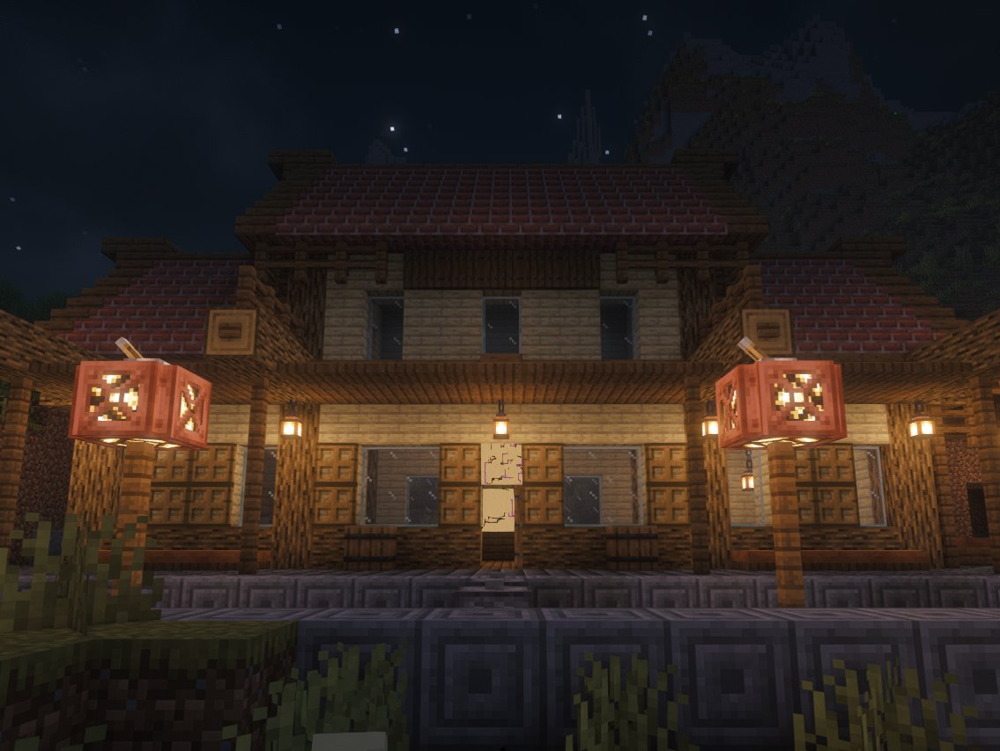

**Server-side. Vanilla clients welcome.**

Villages in Minecraft sit hundreds or sometimes thousands of blocks apart with nothing but wilderness between them. Village Railways joins them with minecart railways. Each village gets lines to up to three of its nearest neighbours. Everything is vanilla blocks, so the railways stay in the world even if you remove the mod later.

Players join with a normal vanilla client and don't need to install anything.

This branch is Minecraft 26.3; the 26.2, 26.1, 1.21.11, 1.21.1 and 1.20.1 versions are on their own branches.

## Screenshots

<p align="center">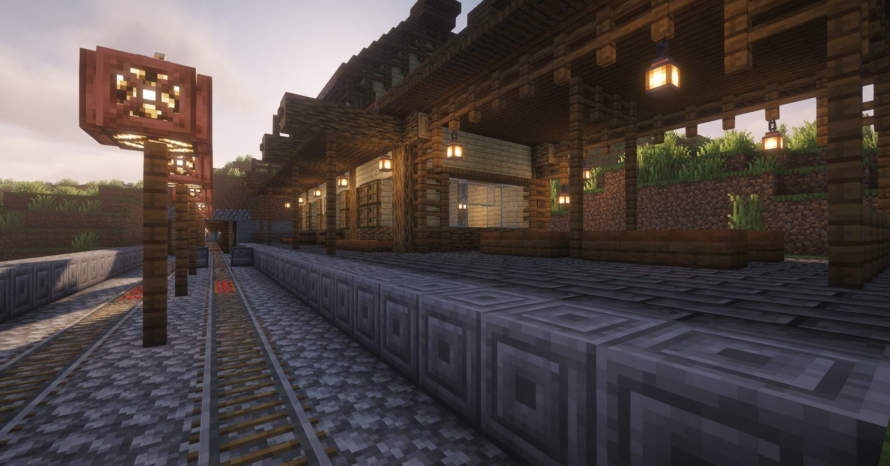<br><em>The platform of a large station.</em></p>

<table>
<tr>
<td width="50%">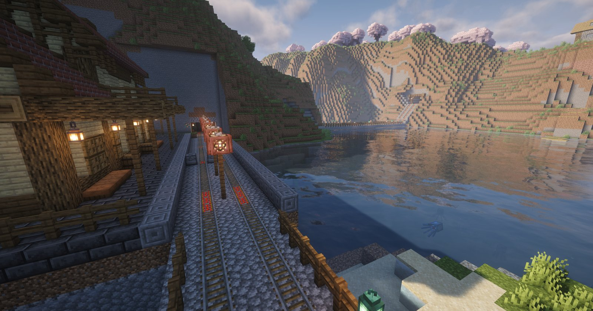<br><em>A station by the lake, at the edge of the village.</em></td>
<td width="50%">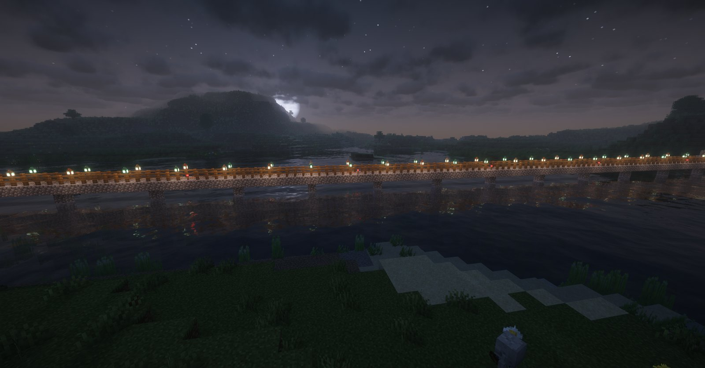<br><em>A double track bridge at night.</em></td>
</tr>
<tr>
<td>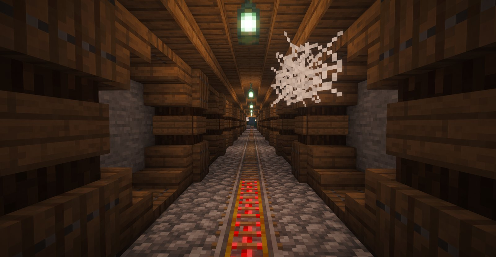<br><em>Inside a long tunnel.</em></td>
<td>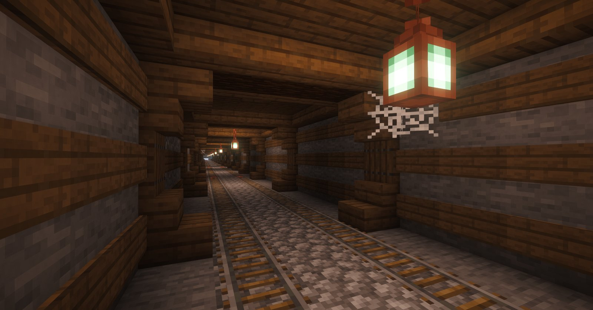<br><em>A double line in a tunnel.</em></td>
</tr>
<tr>
<td>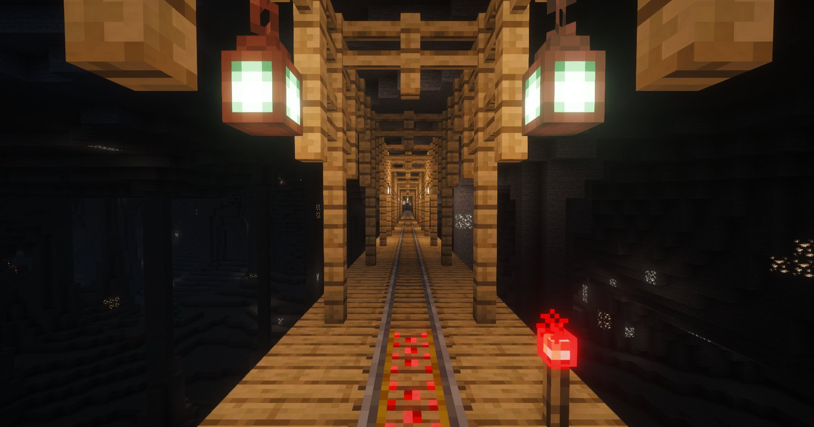<br><em>Where a tunnel breaks into a cave, the line crosses it on a bridge.</em></td>
<td>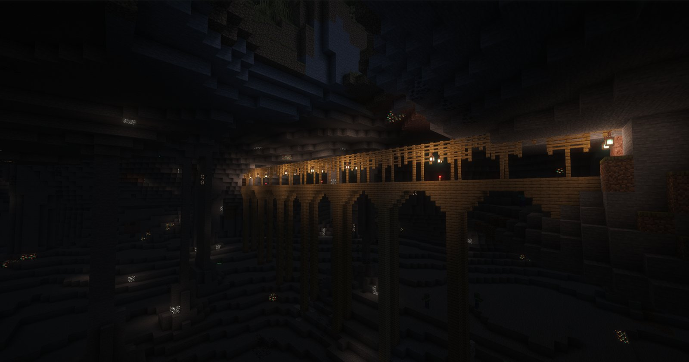<br><em>A cave bridge seen from the floor.</em></td>
</tr>
<tr>
<td>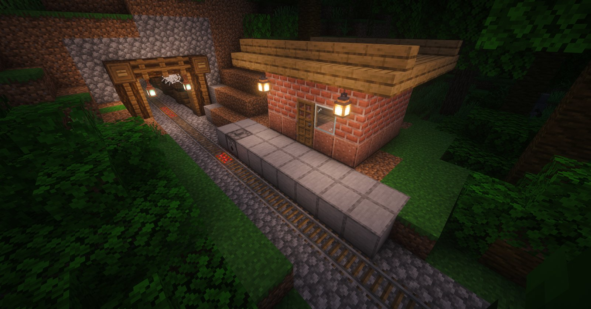<br><em>A halt at the mouth of a long tunnel.</em></td>
<td>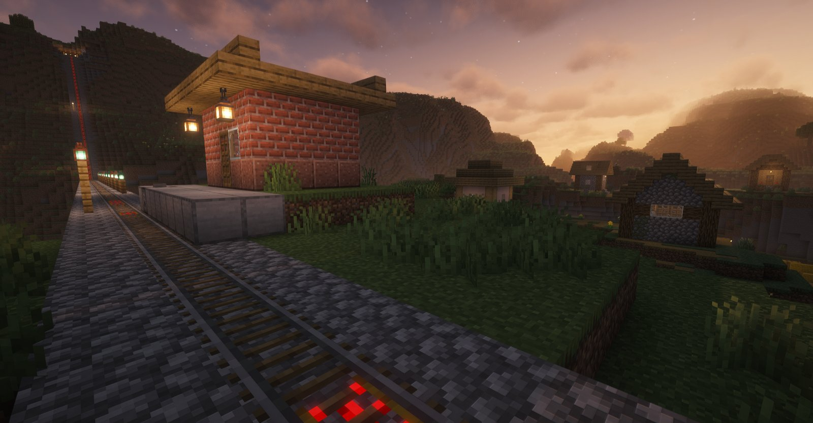<br><em>A halt in the evening.</em></td>
</tr>
<tr>
<td>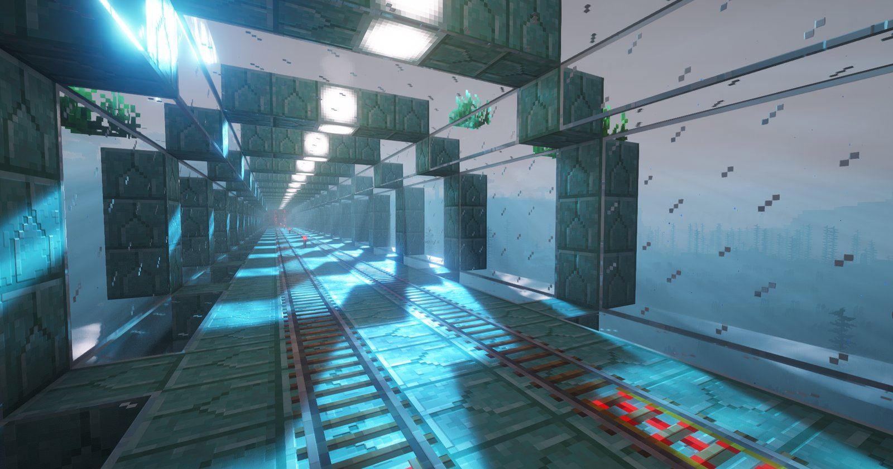<br><em>A glass tube on the sea bed.</em></td>
<td>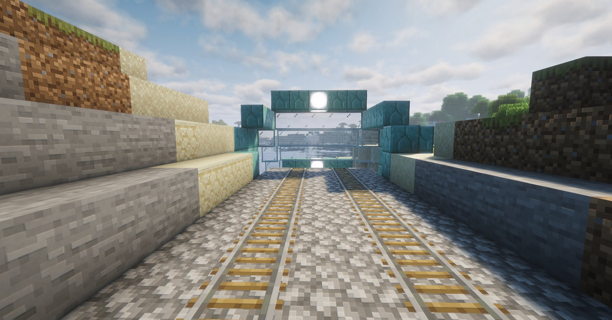<br><em>Where the tube leaves the shore.</em></td>
</tr>
</table>

## What gets built

The track stays level wherever it can. A low hill gets an open cut, a mountain gets a beautiful tunnel, and rivers and ravines get bridges with pillars and railings. If a tunnel breaks into a cave on the way, the line crosses the cave on a bridge. The powered rails run off redstone torches hidden under the track, so you won't see torches every few blocks.

Every village has one station just outside it, where its lines meet. Groups of villages that would otherwise be cut off from the rest are joined by a longer double line, with two tracks all the way, and where one of those comes in, the station may be a large one with a map of the network on the wall. Bridges are double track on every line, and every switch comes with a lever.

On long stretches there are halts, small brick huts by the track with a minecart dispenser, roughly one every 800 blocks. Long tunnels get one at each end.

**Sea tubes are off by default.** If you enable them, a line that meets open water carries on along the sea bed in a glass tube covering two tracks, with prismarine ribs every 5 blocks standing on columns. With them off, lines stay away from the ocean and only bridge narrow straits.

<p align="center">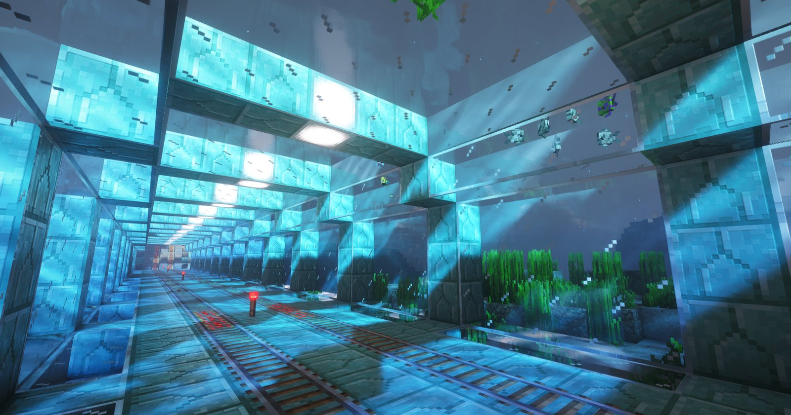<br><em>Inside a sea tube.</em></p>

## Old worlds

Out of the box, lines are only generated in newly explored land, so nothing anyone has built gets touched.

If you want lines through the old land too, a server admin, or the player in a singleplayer world, can force the generation on the existing chunks, in the settings screen ("Open the existing land to lines...", then "Backup and Build") or with `/villagerailways openland`. On the next server start the world is backed up into the `backups` folder first, then the lines are planned through the old land and built as it loads. Lines still keep clear of villages and other structures the game generated, but they know nothing about what players have built, so houses, farms and redstone in their way get cut through, and only the backup can undo that.

## Maps

With `starterMap` turned on, every player joining the world for the first time gets one map of the network, and only that once. `/villagerailways mapitem` gives you a vanilla map of the network that reaches much farther than a normal map would. `/villagerailways mapwall` gives you a set of them to hang as a wall in item frames, the same kind the large stations have.

<table>
<tr>
<td width="50%">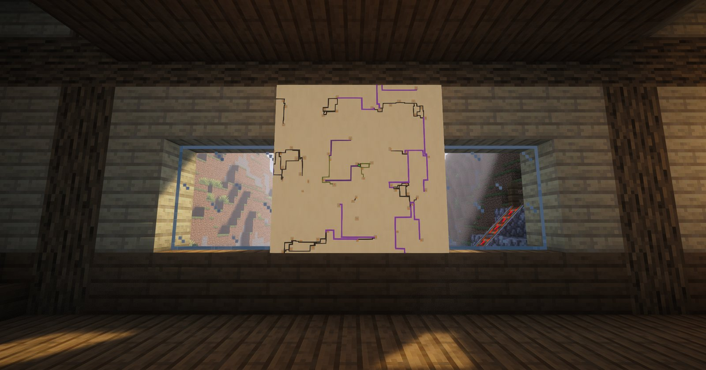<br><em>A map of the network on the wall of a large station.</em></td>
<td width="50%">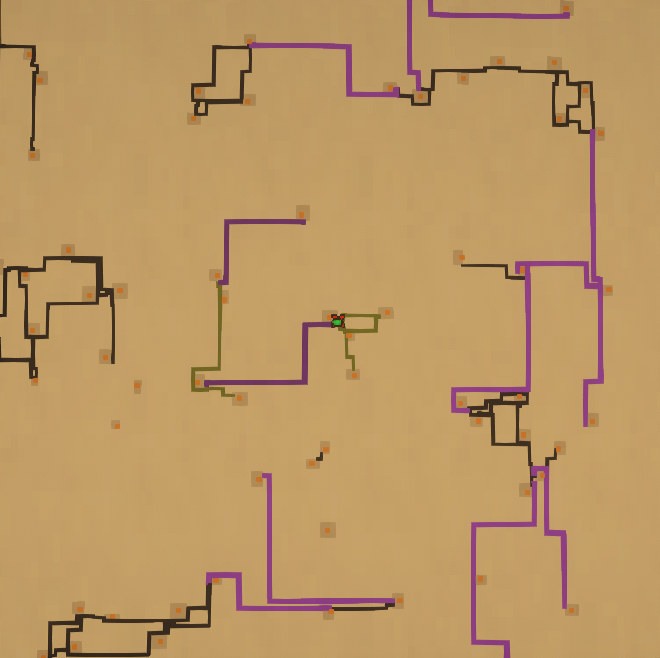<br><em>A network map from <code>/villagerailways mapitem</code>.</em></td>
</tr>
</table>

## Roadmap

Plans for the next versions, in no set order:

- More structures along the lines.
- More styles for tunnels, bridges, stations and the lines themselves, so a line through the desert looks different from one through a snowy forest.

## Available releases

| Minecraft | Loader | Download | Needs |
|---|---|---|---|
| 26.3 | Fabric | [village-railways-fabric-1.0.2+26.3.jar](https://github.com/valcheffnet/village-railways/releases/download/v1.0.2/village-railways-fabric-1.0.2+26.3.jar) | Fabric Loader 0.19+, Fabric API, Java 25 |
| 26.3 | NeoForge | [village-railways-neoforge-1.0.2+26.3.jar](https://github.com/valcheffnet/village-railways/releases/download/v1.0.2/village-railways-neoforge-1.0.2+26.3.jar) | NeoForge 26.3.0.90+, Java 25 |
| 26.3 | Paper | [village-railways-paper-1.0.2+26.3.jar](https://github.com/valcheffnet/village-railways/releases/download/v1.0.2/village-railways-paper-1.0.2+26.3.jar) | Paper 26.3, Java 25 |
| 26.2 | Fabric | [village-railways-fabric-1.0.2+26.2.jar](https://github.com/valcheffnet/village-railways/releases/download/v1.0.2/village-railways-fabric-1.0.2+26.2.jar) | Fabric Loader 0.19+, Fabric API, Java 25 |
| 26.2 | NeoForge | [village-railways-neoforge-1.0.2+26.2.jar](https://github.com/valcheffnet/village-railways/releases/download/v1.0.2/village-railways-neoforge-1.0.2+26.2.jar) | NeoForge 26.2.0.93+, Java 25 |
| 26.2 | Paper | [village-railways-paper-1.0.2+26.2.jar](https://github.com/valcheffnet/village-railways/releases/download/v1.0.2/village-railways-paper-1.0.2+26.2.jar) | Paper 26.2, Java 25 |
| 26.1 | Fabric | [village-railways-fabric-1.0.2+26.1.jar](https://github.com/valcheffnet/village-railways/releases/download/v1.0.2/village-railways-fabric-1.0.2+26.1.jar) | Fabric Loader 0.19+, Fabric API, Java 25 |
| 26.1 | NeoForge | [village-railways-neoforge-1.0.2+26.1.jar](https://github.com/valcheffnet/village-railways/releases/download/v1.0.2/village-railways-neoforge-1.0.2+26.1.jar) | NeoForge 26.1.2.124+, Java 25 |
| 26.1 | Paper | [village-railways-paper-1.0.2+26.1.jar](https://github.com/valcheffnet/village-railways/releases/download/v1.0.2/village-railways-paper-1.0.2+26.1.jar) | Paper 26.1, Java 25 |
| 1.21.11 | Fabric | [village-railways-fabric-1.0.2+1.21.11.jar](https://github.com/valcheffnet/village-railways/releases/download/v1.0.2/village-railways-fabric-1.0.2+1.21.11.jar) | Fabric Loader 0.18+, Fabric API, Java 21 |
| 1.21.11 | NeoForge | [village-railways-neoforge-1.0.2+1.21.11.jar](https://github.com/valcheffnet/village-railways/releases/download/v1.0.2/village-railways-neoforge-1.0.2+1.21.11.jar) | NeoForge 21.11.48+, Java 21 |
| 1.21.11 | Paper | [village-railways-paper-1.0.2+1.21.11.jar](https://github.com/valcheffnet/village-railways/releases/download/v1.0.2/village-railways-paper-1.0.2+1.21.11.jar) | Paper 1.21.11, Java 21 |
| 1.21.1 | Fabric | [village-railways-fabric-1.0.2+1.21.1.jar](https://github.com/valcheffnet/village-railways/releases/download/v1.0.2/village-railways-fabric-1.0.2+1.21.1.jar) | Fabric Loader 0.18+, Fabric API, Java 21 |
| 1.21.1 | NeoForge | [village-railways-neoforge-1.0.2+1.21.1.jar](https://github.com/valcheffnet/village-railways/releases/download/v1.0.2/village-railways-neoforge-1.0.2+1.21.1.jar) | NeoForge 21.1.265+, Java 21 |
| 1.21.1 | Paper | [village-railways-paper-1.0.2+1.21.1.jar](https://github.com/valcheffnet/village-railways/releases/download/v1.0.2/village-railways-paper-1.0.2+1.21.1.jar) | Paper 1.21.1, Java 21 |
| 1.20.1 | Fabric | [village-railways-fabric-1.0.2+1.20.1.jar](https://github.com/valcheffnet/village-railways/releases/download/v1.0.2/village-railways-fabric-1.0.2+1.20.1.jar) | Fabric Loader 0.18+, Fabric API, Java 17 |
| 1.20.1 | Forge | [village-railways-forge-1.0.2+1.20.1.jar](https://github.com/valcheffnet/village-railways/releases/download/v1.0.2/village-railways-forge-1.0.2+1.20.1.jar) | Forge 47+, Java 17 |
| 1.20.1 | Paper | [village-railways-paper-1.0.2+1.20.1.jar](https://github.com/valcheffnet/village-railways/releases/download/v1.0.2/village-railways-paper-1.0.2+1.20.1.jar) | Paper 1.20.1, Java 17 |

Fabric and NeoForge jars go in the `mods` folder, the Paper jar in `plugins`. Mod Menu is optional on Fabric and only adds the settings screen.

The Paper jar also runs on forks of Paper such as Purpur. It does not load on Spigot, CraftBukkit or Folia.

## Optimization

The generation is optimized to be fast and accurate, and it shows its progress in the log and on the loading screen. Keep in mind that, because of some limitations of Minecraft versions before 26.3, the first start of a world takes a bit longer there (around 40 seconds).

## Other world gen mods

Which world gen mods have been tested with Village Railways, and what happens where they meet, is in [COMPATIBILITY.md](COMPATIBILITY.md).

## Settings

With the mod on your client you get a settings screen, through Mod Menu on Fabric or the Config button in the NeoForge mod list. On a server that runs the mod, admins (permission level 3) can change the server's settings from there, and in singleplayer the world's owner always can. The sea tubes also have their own switch on the Create World screen.

Everything is in `config/village_railways.properties` (`plugins/VillageRailways` on Paper), with a comment on each line. Changes apply on the next server start.

| Setting | Default | |
|---|---|---|
| `maxLinks` | `3` | Most lines one village may have, 1 to 3. |
| `maxLength` | `1200` | Longest line between two villages, in blocks. Double lines may be longer. |
| `minRun`, `maxRun` | `32`, `64` | The straight and the side step of a line at a slant. |
| `starterMap` | `0` | `1` gives a player joining the world for the first time a map of the network. |
| `updateCheck` | `1` | When the server starts it asks GitHub once whether a newer version is out, and tells admins when they join. Nothing about the server or its players is sent. `0` turns it off. |
| `supportMessage` | `1` | Admins get a line with the Discord link for questions and bugs when they join. `0` turns it off. |
| `cutDepth` | `5` | Where the ground is higher than this over the rail, the line goes into a tunnel. |
| `pillarSpacing` | `9` | Blocks between the pillars of a bridge in the open. |
| `seaTubes` | `0` | `1` crosses seas in glass tubes. |

Lines that are already planned keep their route. A world also keeps the `cutDepth`, `pillarSpacing` and `seaTubes` it was first started with, so changing those only matters for new worlds.

## Commands

All commands need operator permission (level 2).

| Command | |
|---|---|
| `/villagerailways mapitem [radius]` | A map with the network on it. |
| `/villagerailways mapwall [maps] [radius]` | Maps for a wall of item frames, up to 5 by 5. |
| `/villagerailways lines [radius]` | The planned lines nearby, nearest first, with how far each one is built. |
| `/villagerailways villages [radius]` | The villages the mod expects around you. |
| `/villagerailways openland` | Opens the existing land to lines at the next start; `openland cancel` calls it off. |
| `/villagerailways speed` | Shows your minecart's speed above the hotbar. |
| `/villagerailways network`, `map`, `profile`, `build`, `station`, `verify` | Testing tools that plan, draw or build lines on demand. `build` and `verify` generate chunks, so use them only in test worlds. |

## Building from source

```
./gradlew build
./gradlew -p neoforge build
./gradlew -p paper build
```

All three come from the same sources. The jars end up in `build/libs`, `neoforge/build/libs` and `paper/build/libs`.

## Feedback

Found a bug or have an idea? Come to [Discord](https://discord.com/invite/X6yxJpk9Fz) or open an [issue](https://github.com/valcheffnet/village-railways/issues). If it's a bug, the seed and the coordinates help a lot, and screenshots of your lines are always welcome.

## License

All rights reserved. You may use the mod on any server, put it in modpacks and share the unmodified jars; the code and assets may not be used in other projects. See [LICENSE.md](LICENSE.md).

The mod icon is [Railway](https://www.flaticon.com/free-icon/railway_10682260) by Nueng_wana from Flaticon.
